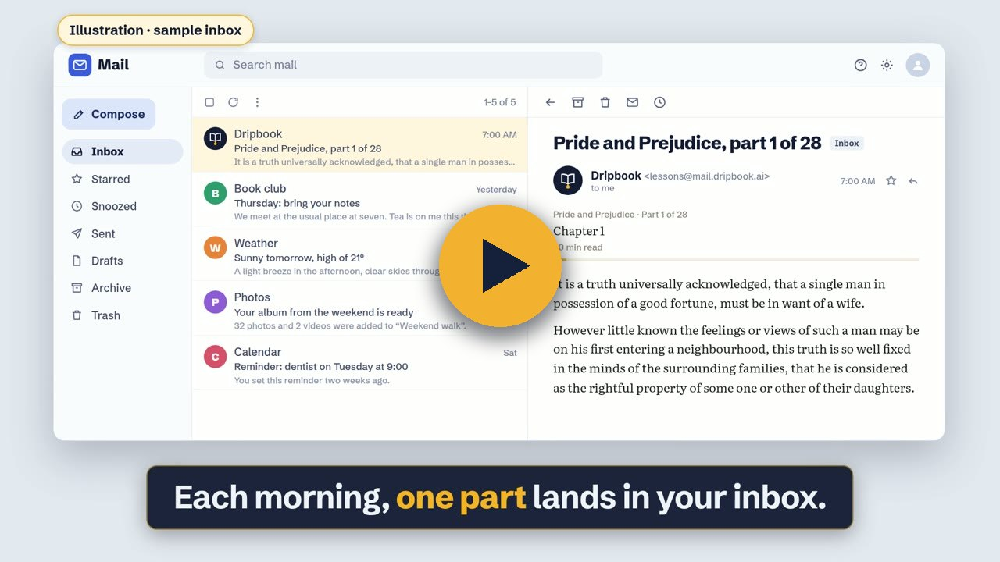

# Dripbook

Read a book in daily installments, right from your inbox.

[Browse the library](https://dripbook.ai) · [Dripbook for authors](https://dripbook.ai/authors)

▶ [Watch the 30-second demo on YouTube](https://youtu.be/jLlsHZCnHLE), with sound. It also plays on [How it works](https://dripbook.ai/how), and the file is [dripbook-demo.mp4](https://assets.dripbook.ai/video/dripbook-demo.mp4).

Pick a classic, choose a reading pace, and get the next part by email. Authors can turn their own ebooks into paid email courses.

## From book to inbox

| Choose your reading pace | Edit the lesson breaks |
| --- | --- |
|  |  |

[Setup and development](docs/development.md) · [Roadmap](ROADMAP.md)
