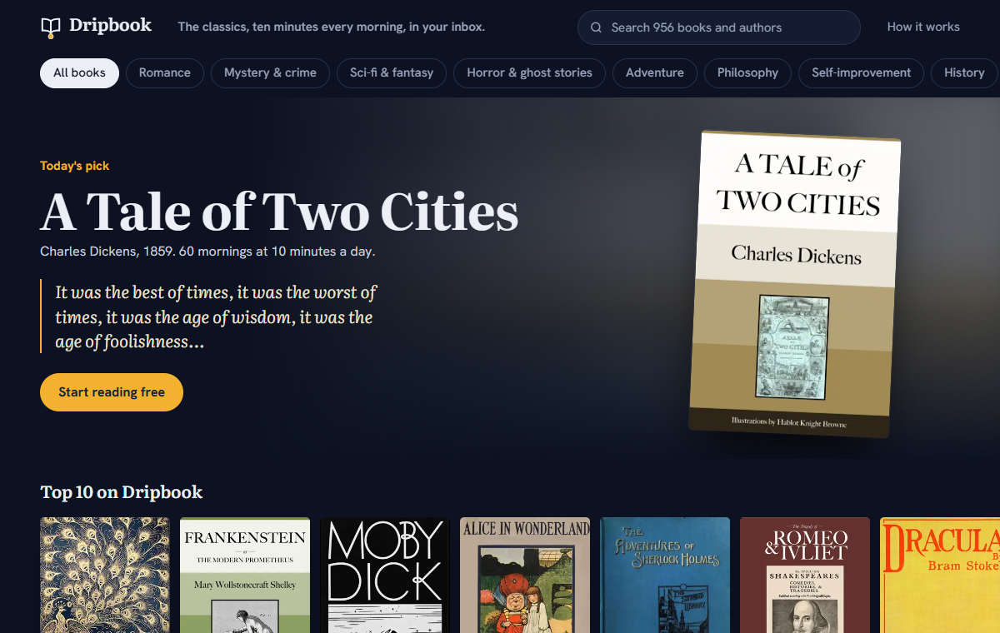
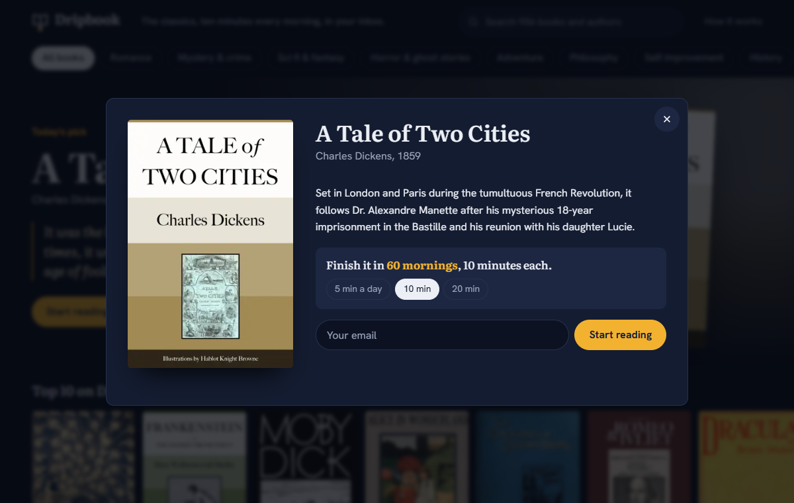
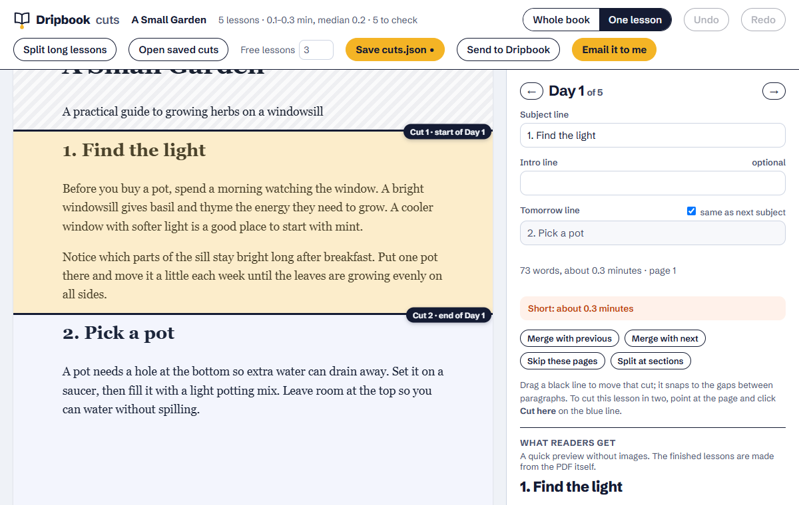

# Dripbook

Read a book in daily installments, right from your inbox.

[Browse the library](https://dripbook.ai) · [Dripbook for authors](https://dripbook.ai/authors)

Pick a classic, choose a reading pace, and get the next part by email. Authors can turn their own ebooks into paid email courses.

## From book to inbox

| Choose your reading pace | Edit the lesson breaks |
| --- | --- |
|  |  |

[Setup and development](docs/development.md) · [Roadmap](ROADMAP.md)
